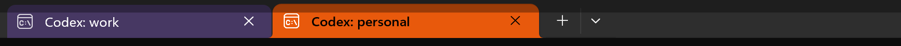

# accounts-for-codex

One Codex CLI login per account, side by side, in PowerShell.



Codex keeps its login, settings and history in one folder, `CODEX_HOME`. Two windows that point at two folders are two accounts signed in at the same time: a work seat and a personal plan, or one account per client. This module sets that up and keeps it tidy:

```powershell
New-CodexAccount work
codex-as work                      # the first run asks you to sign in, once
codex-as work exec "summarize this repo"
```

On Windows it can also give each account its own Windows Terminal profile, with the account's name on the tab and its own color, so you can see which account you're typing into.

It runs in Windows PowerShell 5.1 and PowerShell 7, on Windows, macOS and Linux. It never copies, moves or prints a login.

This is for the Codex **CLI**. The ChatGPT desktop app needs more than an environment variable; for that there is [Sessions Pro for Codex](https://multiplecodex.com/), a paid app by the same developer.

## Install

```powershell
git clone https://github.com/lexmediaro/accounts-for-codex.git
cd accounts-for-codex
.\install.ps1
```

`install.ps1` copies the module into your own PowerShell modules folder. No administrator rights, nothing system-wide. Open a new PowerShell window afterwards.

If PowerShell says that running scripts is disabled, allow local scripts for your user once:

```powershell
Set-ExecutionPolicy -Scope CurrentUser RemoteSigned
```

You need the [Codex CLI](https://github.com/openai/codex) on your PATH.

## Use

| Command | What it does |
|---|---|
| `New-CodexAccount work` | Creates an empty account folder. Add `-CopyConfigFrom default` to start with the same `config.toml` (settings and MCP servers). |
| `codex-as work [codex arguments]` | Runs Codex once as that account. Everything after the name goes to Codex as you typed it, including options like `-m` and `-c` and a `--` separator. |
| `Enter-CodexAccount work` | Makes this window use that account, for plain `codex` and anything else you start from it. `Exit-CodexAccount` puts it back. |
| `Get-CodexAccount` | Lists your accounts, who is signed in to each (e-mail and plan), and which one this window uses. |
| `Add-CodexTerminalProfile work` | Windows: adds a "Codex: work" profile to Windows Terminal. Options: `-TabColor '#1A7F37'`, `-Shell pwsh`. Restart Windows Terminal to see it. |
| `Remove-CodexTerminalProfile work` | Removes that profile again. |
| `Remove-CodexAccount work` | Deletes the account folder, with its login, settings and history. Asks first. |

Account names complete with Tab. Your normal Codex folder shows up as `default`, so `codex-as default` works too.

```text
PS> Get-CodexAccount

Name     SignedIn Email               Plan Current
----     -------- -----               ---- -------
default      True you@example.com     plus    True
personal    False                            False
work         True you@company.example team   False
```

## What it changes

Read this part first. It's your machine.

| Where | What |
|---|---|
| `~/.codex-accounts/<name>/` | One folder per account, created by `New-CodexAccount`. Codex itself writes that account's login, settings and history into it. Set `CODEX_ACCOUNTS_HOME` to keep the folders somewhere else. |
| `CODEX_HOME` | Set for one run (`codex-as`) or for the current window (`Enter-CodexAccount`), then put back. It is never saved for your user or the system. |
| `%LOCALAPPDATA%\Microsoft\Windows Terminal\Fragments\AccountsForCodex\<name>.json` | One small file per profile you add with `Add-CodexTerminalProfile`. Your Terminal `settings.json` is not edited. |

What it never does:

- It doesn't write to your normal `~/.codex` folder. It only reads there who is signed in, to show it in the list.
- It doesn't copy or move `auth.json`. Each account signs in the normal way, in its own folder.
- It doesn't show or send a token anywhere. It makes no network requests at all.

## Good to know

- **Don't copy `auth.json` between folders.** It is the login: a copy puts the same account in both places. `-CopyConfigFrom` copies `config.toml` only.
- **Don't use `setx CODEX_HOME`.** A user-wide value is inherited by every program you start, including the ones that should use your normal account. This module only ever sets it for one run or one window.
- **Credentials in the system credential store.** If your Codex config sets `cli_auth_credentials_store` to something other than a file, there is no `auth.json` to read and the list shows `SignedIn` as `False` even when you are signed in. Ask Codex itself: `codex-as work login status`.
- **The `--` separator.** PowerShell normally swallows a bare `--` before a function sees it. `codex-as` puts it back where you typed it, so `codex-as work mcp add docs -- npx -y some-server` works. If a command spans several lines and the `--` goes missing, quote it: `'--'`.
- **Use accounts that are yours.** A work seat next to a personal plan is the normal case. OpenAI's terms don't allow sharing an account or using extra accounts to get around rate limits, and this module doesn't rotate or pool anything: one window, one account.

## Uninstall

```powershell
.\install.ps1 -Uninstall
```

That removes the module. Your accounts in `~/.codex-accounts` stay; delete them with `Remove-CodexAccount` first if you want them gone, and remove Terminal profiles with `Remove-CodexTerminalProfile`.

## Tests

```powershell
pwsh -NoProfile -File tests/Test-AccountsForCodex.ps1
powershell -NoProfile -ExecutionPolicy Bypass -File tests\Test-AccountsForCodex.ps1
```

The tests work in a temporary folder with a stand-in for the Codex CLI. They don't touch your real accounts or your Terminal settings.

## License

MIT. See [LICENSE](LICENSE).

Not affiliated with, endorsed by or sponsored by OpenAI. Codex and ChatGPT are trademarks of OpenAI.
